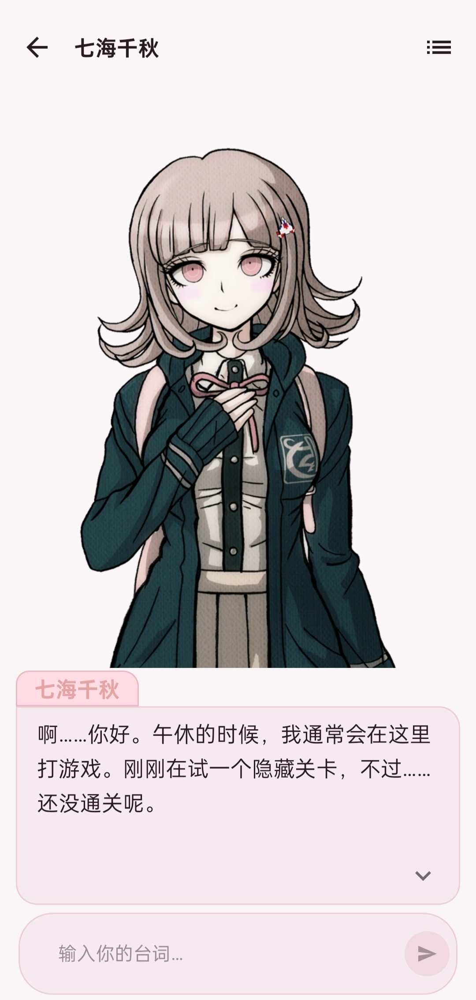

# 新世界 · Shinsekai Android

桌面版 [Shinsekai](https://github.com/RachelForster/Shinsekai) 的**非官方 Android 轻量移植**：用大语言模型驱动角色对白，**立绘随情绪切换**，可选接入**云端语音合成与音色克隆**，在手机上进化成一套 VN（视觉小说）式的演出交互——一次一句台词、点击推进、打字机逐字浮现。

> 本移植版已与上游作者取得联系并获得许可，以 **APK 形式在 [Releases](https://github.com/Asriel-cute/Shinsekai-Android/releases) 发布**（暂不上架应用商店）。最低系统要求 Android 11（API 30）；APK 内**不含任何角色、立绘或语音资源**，角色包需自行导入；示例 `.voice` 语音包如发布将经 Releases 另行分发并附免责声明，见[许可与资源版权](#许可与资源版权)。

---

## 目录

- [界面展示](#界面展示)
- [首次使用](#首次使用)
- [它是什么](#它是什么)
- [与桌面版的差异](#与桌面版的差异)
- [自行构建](#自行构建)
- [数据格式](#数据格式)
- [接口约定](#接口约定)
- [架构](#架构)
- [本地数据布局](#本地数据布局)
- [已知限制](#已知限制)
- [致谢](#致谢)
- [许可与资源版权](#许可与资源版权)

---

## 界面展示

<p align="center">
  
</p>

VN 演出主界面：立绘舞台 + 姓名牌 + 对话框（一次一句、点击推进、打字机逐字浮现），底部输入栏（生成中变为停止条）。

> 截图中的角色与立绘版权归原作者，仅用于功能演示；仓库与 APK 不含同类资源。

---

## 首次使用

首次安装启动时会展示 **6 页新手引导**（欢迎 / 配置 LLM / 导入角色 / 新建对话 / 对话操作 / 可选语音）：每页配界面示意图与要点，读完最后一页即可开始，中途可随时跳过，完成后不再自动出现。已有角色、会话或音色卡的老用户升级后不会看到，想重看可到**设置 → 关于 → 查看新手引导**。

### 1. 配置 LLM

设置页 → 选择**提供商**（OpenAI / Anthropic / Google）；OpenAI 还需选**接口形态**（Responses / Chat Completions，兼容网关一般选后者）。填 **BaseUrl**、**API Key**（无需密钥的本地网关可留空）、**模型名称**，点「获取模型列表」可从服务商拉取候选（用当前草稿配置，不必先保存），「测试连接」会发一次 16 token 的小请求并回报耗时。最后「保存」。

**推理档位**（无 / 低 / 高 / 最高）对三家统一生效，映射方式见[接口约定](#llm)。

### 2. 导入角色包与背景包

角色页 →「导入」→ 选择 `.char` 或 `.bg` 文件（本质都是 ZIP），应用按包内容**自动识别类型**。角色包只认根目录的 `character.yaml` 与 `sprites/`、`speech/` 两个目录，`models/**` 等其余内容不读不解压。

- 出现同名角色时弹窗「发现同名角色」，可选**覆盖**（沿用原角色 ID，绑定关系保留）或**保留两者**（新 ID，名字自动加「（1）」「（2）」）。
- 某张立绘的图片或语音在包内找不到时，该槽位留空并给出警告，**不会删项、不会重排编号**。
- 社区角色包可从角色页右上角「下载」进入资源页获取：<https://shinsekai.end0rph1n.icu/resources>

背景包（`.bg`）导入后在角色页**「背景包」分组**展示（首图缩略与场景/音乐数量），长按删除；同名冲突的处理方式与角色包一致。包格式见[数据格式 · `.bg` 背景包](#bg-背景包)。

### 3. 新建对话

会话页 →「新建对话」→ 勾选一个或多个出场角色 →（可选）选择「主控角色」→（可选）选择「背景包」→ 填写「情景」（描述背景与开场，可留空）→「开始对话」。

主控必须从已选角色中指定，且至少要有两位角色。设置后 AI 可以为主控补充日常台词和反应，并自行判断是否复述你输入的台词：需要复述时可适当润色补充，有云语音时会朗读；不需要时直接推进剧情，不强制复述。涉及主控的关键行动、重大选择、承诺或立场，AI 会尽量等待你的回复，不替主控作决定。

绑定背景包后，AI 会在开场自动设置初始场景与 BGM，并随剧情推进切换；重进会话按历史记录恢复最后的场景与 BGM，无记录时回落场景 1 + BGM 1。

此刻会**现场拼装系统提示词并作为快照写入会话历史**：出场人物、JSON 输出契约、每个角色的立绘数量与情绪标签、角色设定、主控规则、台词与旁白规范，（若有角色绑定了音色卡）翻译字段要求，以及（若绑定了背景包）场景与 BGM 目录及切换规则。情景文本会被拼接在提示词末尾之前，保证提示词始终以「必须以规定的 JSON 格式回复。」收尾。

在会话列表点击已有会话会进入同一个**会话设置页**：可修改角色、主控、背景包、情景与云语音开关，保存时按当前配置重新生成 system 提示词快照，已有历史记录不动。

### 4. 可选：让角色开口

语音页 →「添加」手填音色卡（适合已在服务商官网克隆好音色、拿到 Voice ID 的情况；需填服务商、BaseUrl、API Key、模型、Voice ID、语音语言），或「克隆」复刻音色（适合第一次使用）——克隆页支持「一键导入.voice语音包」自动带入素材与参考文本，也可分别选择克隆音频、参考音频与参考文字。

拿到音色卡后，到**角色详情页 → 角色声音**绑定给角色。**语音语言与翻译规则在建会话时写入提示词，改动后在会话设置页重新保存即可对已有会话生效。**

配音优先级：角色绑定了云音色卡 → 用云合成（台词按队列串行合成，避免限流）；未绑定 → 播放立绘自带的本地台词音频，且只在**立绘实际切换**时播放（`voice_type` 为 `reference` 的参考音频不播）。主控例外：主控台词不播本地立绘录音，有云语音才合成，否则只显示文字。会话设置页另有会话级「云语音」开关（默认开启），关闭后绑定的云音色卡全部让位，照常播放本地立绘音频。

---

## 它是什么

底部四个 Tab——**会话 / 角色 / 语音 / 设置**，每个 Tab 各自持有独立返回栈：

| 页面 | 作用 |
|------|------|
| **会话** | 会话列表（带最后一句预览）；点击条目进入**会话设置页**（编辑后保存会重生成提示词快照），长按重命名 / 删除；右上角「新建对话」 |
| **新建对话** | 多选出场角色 +（可选）主控角色 +（可选）背景包 + 填写「情景」，点「开始对话」进入演出 |
| **聊天** | VN 演出主界面：全屏场景背景图 + 立绘舞台 + 姓名牌 + 对话框，一次只显示一句台词，点击推进；BGM 循环播放（离开聊天页即停），右上角「设置」内可调 BGM 音量（拖动实时试听、松手落盘）；生成中底栏为停止条，可随时打断发送（只保留已上屏的台词）；顶栏「聊天记录」可查看完整历史（未完成片段标记为「未完成」），面板顶部有 token 用量估算与「压缩」按钮，用户消息可**回溯** |
| **角色** | 角色卡片列表与「背景包」分组；右上角「导入」自动识别 `.char` / `.bg` 包，「下载」跳转社区角色包资源页；长按删除；详情页可看设定、情绪标签、立绘缩略图，并绑定「声音卡片」 |
| **语音** | 音色卡列表；「添加」手填配置，「克隆」复刻音色（支持一键导入 `.voice` 语音包）；长按删除，可选「普通删除」（仅本地）或「彻底删除」（连带云端音色） |
| **设置** | LLM 提供商、接口形态、BaseUrl、API Key、模型名称、推理档位；「获取模型列表」「测试连接」「保存」；「外观」主题切换（跟随系统/浅色/深色，即时生效）；关于页可「查看新手引导」 |

**演出细节**：旁白与陌生名字使用中性姓名牌，并把当前立绘调暗到 40% 透明度而不切图；台词打字中点击立即补全；对话框最小 130dp、随台词增高，超过约 5 行内部滚动（用隐形占位文本防止抖动）；语音未就绪时显示「语音准备中…」，点击不会跳过。停止或生成结束后输入栏常驻（报错时除外），此时发送新内容会立即丢弃未播放的语音队列。

**隐私**：只申请 `android.permission.INTERNET` 一个权限。没有麦克风、没有存储权限（导入走系统文件选择器），没有统计与埋点；所有配置、角色、会话都是设备本地的 JSON 文件，API Key 以 Android Keystore 的 AES-GCM 密文存放。

---

## 与桌面版的差异

移植只保留「角色演出」这一条主线，桌面版的扩展生态一律没有搬运。

| | 说明 |
|---|---|
| **保留** | 角色包导入（`character.yaml` + `sprites/` + `speech/`）、立绘情绪联动、流式 LLM 对话、会话历史与存档、云 TTS 台词配音、音色克隆、`.voice` 语音包、`.bg` 背景包（场景图切换 + BGM） |
| **未移植** | 插件系统与插件 SDK、MCP、文生图（ComfyUI 等）、语音识别 ASR、长期记忆、聊天皮肤/主题编辑器、CG / 特效、`.char` **导出**、模板可视化编辑与持久化、CHOICE / STAT / COT 标记、界面多语言、整合包与安装脚本、Tauri 桌面壳 |
| **额外收窄** | 舞台一次只显示一张立绘（无多立绘同屏）；只有云 TTS，无本地/系统 TTS 引擎；上下文压缩仅手动、无自动裁剪；不支持编辑单条消息（可回溯用户消息改写重发，assistant 消息只有整轮失败后「重试」）；无深链；前端不截断台词长度 |

---

## 自行构建

### 环境要求

| 项目 | 版本 |
|------|------|
| Gradle | 9.8.2（wrapper 自带） |
| Android Gradle Plugin | 9.5.0（AGP 9 DSL，Kotlin 由 AGP 内置支持） |
| Kotlin | 2.4.21 |
| compileSdk / targetSdk | API 37（minor 2） |
| minSdk | API 30（Android 11） |
| Java 源/目标兼容级别 | 11 |
| Compose BOM | 2026.09.00 |

Gradle 守护进程的 JVM 由 `gradle/gradle-daemon-jvm.properties` 固定为 **toolchain 26**，首次构建时通过 foojay 解析器自动下载，本机无需预装该版本 JDK。你需要自行准备 Android SDK（含 API 37 平台）。

### 构建步骤

```powershell
# 1) 在仓库根目录创建 local.properties（已被 .gitignore 忽略）
#    sdk.dir=D\:\\androidSDK

# 2) 编译
.\gradlew.bat :app:assembleDebug

# 3) 产物
#    app\build\outputs\apk\debug\app-debug.apk
```

静态检查：`.\gradlew.bat :app:lintDebug`。

`release` 构建类型只开启了代码优化，**没有内置 `signingConfig`**（密钥不入库，`.gitignore` 已排除 `*.jks` / `*.keystore`）。发布用 APK 由维护者本地签名后上传到 Releases；自行构建时可用 Android Studio 的 *Generate Signed App Bundle / APK* 或 `apksigner` 完成签名。日常调试装 debug 包即可。

---

## 数据格式

### `.char` 角色包

```
角色包.zip
├─ character.yaml        # 必需，位于根目录
├─ sprites/              # 立绘图片，按编号与 yaml 顺序对应
│  ├─ 01.png
│  └─ 02.png
├─ speech/               # 立绘绑定的台词音频（可选）
│  └─ 01.mp3
└─ models/…              # 忽略：不读、不解压
```

`character.yaml` 的根节点既可以是单个角色，也可以是**角色列表**（一个包放多个角色，此时用 `sprite_prefix` 区分各自的资源目录）。

| 键 | 说明 |
|---|---|
| `name` | 角色名，必填；为空则跳过该条目并给出警告 |
| `color` | 十六进制颜色，用于姓名牌文字与描边 |
| `sprite_prefix` | 多角色共用一个包时的资源目录前缀，仅用于消歧 |
| `character_setting` | 角色设定，进入提示词的「角色说明」 |
| `emotion_tags` | 情绪标签说明，进入提示词的「立绘说明」 |
| `sprite_scale` | 立绘高度占比，取值 0.1–1.0，默认 1.0 |
| `speech_speed` / `speech_volume` | **本地**台词音频的播放速度 / 音量，默认 1.0 |
| `sprites` | 立绘列表，元素可以是对象，也可以直接是路径字符串；**顺序即编号** |
| `sprites[].path` | 立绘图片路径（只取文件名后按名匹配包内资源） |
| `sprites[].voice_path` | 该立绘绑定的台词音频 |
| `sprites[].voice_text` | 台词文本 |
| `sprites[].voice_type` | `preset` / `fallback` / `reference`；非法值时按有无 `voice_text` 回落为 `reference` 或 `fallback` |

导入采用**整包暂存 + 提交**：先解到 `characters/.staging/{token}/`，全部角色校验通过后才原子地移入正式目录；`PK` 头压缩包优先走 `ZipFile` 随机读取（跳过 `models/` 而不必流式读完），失败再回落 `ZipInputStream`。暂存目录在每次启动时清空。

### `.bg` 背景包

```
背景包.zip
├─ background.yaml        # 必需，位于根目录；可以是单个背景，也可以是列表（一包多组）
├─ sprites/               # 场景图片，按编号与 yaml 顺序对应
│  ├─ 1.png
│  └─ 2.jpg
└─ bgm/                   # 背景音乐（可选）
   └─ 1.flac
```

`background.yaml` 的根节点既可以是单个背景，也可以是**背景列表**（一个包放多组，此时用 `sprite_prefix` 区分各自的资源目录）。

| 键 | 说明 |
|---|---|
| `name` | 背景组名称，必填；为空则跳过该条目并给出警告 |
| `sprite_prefix` | 多组共用一个包时的资源目录前缀，仅用于消歧 |
| `sprites` | 场景图列表，元素可以是对象（取 `path` 键），也可以直接是路径字符串；**顺序即编号** |
| `bg_tags` | 「场景 N：描述」逐行原文，进入提示词供 AI 理解各场景 |
| `bgm_list` | BGM 路径列表，格式同 `sprites`；**顺序即编号** |
| `bgm_tags` | 「音乐 N：描述」逐行原文，进入提示词 |

旧式包内的 `data/backgrounds\prefix\` 前缀路径不可靠，素材引用只按**文件名**匹配包内资源。某项素材在包内找不到时该槽位留空并给出警告，不删项、不重排编号。导入流程与 `.char` 相同（整包暂存 + 提交，暂存目录启动时清空）；背景包体积通常较大（场景图 + 无损音乐可达数百 MB），导入耗时与占用空间约为包体 2 倍。

### `.voice` 语音包

ZIP 内含 `manifest.json` 与音频文件：

```json
{
  "name": "音色名称",
  "lang": "ja",
  "clone_path": "clone.wav",
  "prompt_path": "prompt.wav",
  "prompt_text": "与参考音频一致的文字"
}
```

`name` 必填；`lang` 支持 `zh` / `ja` / `en`，留空即 Auto（由服务商自行判定），常见别名会自动归一化（`cn`/`chinese`/`cmn`/`hans` → `zh`，`jp`/`jpn`/`japanese` → `ja`，`eng`/`english` → `en`）。遇到不支持的语言会回落为 Auto 并提示。

---

## 接口约定

### LLM

| 提供商 | 流式端点（相对 BaseUrl） | 鉴权头 | 推理档位映射 |
|---|---|---|---|
| OpenAI · Responses | `responses` | `Authorization: Bearer` | `reasoning.effort`；选「无」也显式下发，用于关闭服务端默认思考 |
| OpenAI · Chat Completions | `chat/completions` | `Authorization: Bearer` | `reasoning_effort`；仅非「无」时下发，避免不支持的模型报错 |
| Anthropic | `v1/messages` | `x-api-key` + `anthropic-version: 2023-06-01` | thinking 预算 低 2048 / 高 8192 / 最高 12288；开启 thinking 时不下发 `temperature` |
| Google Gemini | `v1beta/models/{model}:streamGenerateContent?alt=sse` | `x-goog-api-key` | `thinkingConfig.thinkingBudget` 低 1024 / 高 8192 / 最高 -1（动态） |

共同约定：采样温度固定 **0.7**；一律要求 JSON 输出（`text.format.type=json_object` / `response_format` / `responseMimeType`）；Anthropic 的 `max_tokens` 为 16384，system 快照会提到顶层字段，连续同角色消息自动合并。流式解析为**手写 SSE 行循环**（Retrofit `@Streaming`，未使用 okhttp-sse），各家差异封装在 `ProviderSpec` 实现里。

取消与失败都以事件形式回到 UI，**终止事件携带 LLM 原文**，便于排查：正常结束 `Completed(raw)`、用户取消 `Cancelled(raw)`、上游错误 `Error(raw, message)`。

### 对话 JSON 契约

模型必须输出：

```json
{"dialog":[{"name":"角色名","sprite":"01","speech":"简体中文台词","translate":"语音合成用朗读文本（可省略）"}]}
```

- `sprite` 是**字符串形式的 1 基编号**（`"01"`、`"02"`…），指立绘代号或场景/BGM 编号（见下条）；`"-1"` 表示不切换；无立绘角色与旁白固定 `-1`。
- 绑定背景包的会话使用保留名 **`SCENE` / `场景`**（切场景图）与 **`bgm`**（不区分大小写，切音乐）：这类**展示条目**的 `sprite` 为场景/BGM 的 1 基编号，到达时立即生效并自动续播，**不占点击、不上屏、不播语音**；构建 LLM 上下文与记录面板时会过滤，但保留在本地历史里供重进会话恢复。
- `translate` 只在角色绑定了音色卡时才要求（ja/en 为译文、zh 为中文纯台词、Auto 由模型自判语言），**仅供语音合成使用**，不会显示在对话框里。
- 解析器 `DialogJsonParser` 在流上**增量扫描**：每闭合一个 `{…}` 立即产出一条台词；容忍缺字段、`null`、带引号的数字、尾逗号、多余的右括号与未知键。
- **没有纯文本回退**：解析不出任何 `dialog` 就按「回复格式异常」报错；也不兼容 `character_name` 之类的旧键名。

### 云 TTS

| 服务商 | 音色克隆 | 语音合成 | 语言控制 |
|---|---|---|---|
| **阿里百炼**（DashScope CosyVoice） | `services/audio/tts/customization` + `action=create_voice`（音频以 Base64 data URI 上传），随后每 2 秒轮询 `query_voice`，最多 30 次直到 `status=OK`；`UNDEPLOYED` 视为审核未通过 | `services/audio/tts/SpeechSynthesizer`，带 `X-DashScope-SSE: enable`，把 SSE 分片中的 Base64 音频拼接成 mp3 | `language_hints` |
| **MiniMax** | `files/upload`（`purpose=voice_clone` / `prompt_audio`）→ `voice_clone`；`voice_id` 由用户自定义（8–256 位、字母开头、仅字母数字与 `-` `_`、不以 `-` `_` 结尾） | `t2a_v2`，音频在 `data.audio` 中以 **hex** 编码返回 | `language_boost`（Chinese / Japanese / English / auto） |

绑定音色卡的角色要求台词带非空 `translate`（ja/en 为译文、zh 为中文纯台词、Auto 由模型自判角色语言），否则**跳过该条语音**并抑制本地音频，队列播完后统一提示。建会话时会把各角色的语言快照写进 `voiceLanguages`；没有快照的角色静默跳过云合成。

---

## 架构

```
app/src/main/java/com/dreemurr/shinsekai/
├─ MainActivity.kt / MainApplication.kt   单 Activity；edge-to-edge，根 Scaffold 统一处理 insets
├─ di/            AppContainer（手动依赖注入容器）+ LocalAppContainer
├─ character/     角色模型、character.yaml 解析、包导入、原子落盘
├─ background/    背景包模型、background.yaml 解析、导入与素材存取
├─ session/       会话模型与存取（含提示词快照、语言快照、历史）
├─ chat/          LLM 提供商封装、手写 SSE、流事件、DialogJsonParser、手动上下文压缩（ContextCompressor / TokenEstimator）
├─ template/      提示词现场拼装（**不依赖任何 Android API**，可单测）
├─ voice/         音色卡、绑定关系、TTS 接口、.voice 包读取、MediaPlayer 播放、BgmPlayer 循环 BGM
├─ settings/      DataStore 配置仓库、ApiKeyCipher（Keystore AES-GCM）
└─ ui/            navigation / sessions / newsession / chat / characters / voices / settings / theme / common
```

**技术栈**：Kotlin + Jetpack Compose（Material 3）；MVVM + `StateFlow`；**Navigation 3** 多 Tab 独立返回栈；Retrofit 3 + OkHttp 5 + kotlinx.serialization；kaml 解析角色 / 背景 YAML；Coil 3 加载立绘与场景图；DataStore Preferences 存设置；无数据库，全部走**原子写 JSON**（临时文件 + rename）。

**几条贯穿全局的约定**：

- insets 由 `MainActivity` 根 Scaffold 统一 padding 并 consume，子页面不再补状态栏；底部输入区自行处理 `navigationBarsPadding().imePadding()`。
- 打字机进度是独立 `StateFlow`，只在文本组件内收集，避免整屏重组。
- 提示词只作为会话创建时的 system 快照存在，不做持久化模板，也不支持回改。
- 流事件到达即落盘；异常中断留下 `complete=false` 的残片，下一轮请求会自动过滤，「重试」会替换掉结尾残片而不是叠加。ViewModel 销毁时用 application 级作用域补落最后一段原文。

---

## 本地数据布局

```
filesDir/
├─ characters/{uuid}/character.json      角色元数据
│             ├─ sprites/                立绘图片
│             └─ speech/                 立绘台词音频
├─ characters/.staging/                  导入暂存，启动时清空
├─ backgrounds/{uuid}/background.json    背景包元数据
│              ├─ sprites/               场景图片
│              └─ bgm/                   背景音乐
├─ backgrounds/.staging/                 导入暂存，启动时清空
├─ sessions/{id}.json                    会话：标题、角色、主控、背景包、情景、语言快照、完整历史
├─ voice_cards.json                      音色卡列表（API Key 为 Keystore 密文）
└─ voice_bindings.json                   角色 → 音色卡 的绑定关系

cacheDir/
├─ tts/{sessionId}-{n}.mp3               云合成音频，换轮或退出时清理
└─ voice_clone/{uuid}/                   克隆用临时音频

DataStore: chat_settings                 LLM 配置（Key 同样是密文）
```

角色目录各自独立、没有全局索引（列表靠扫描目录并按导入时间排序），因此**备份或迁移就是拷贝 `filesDir` 下的这些文件**；单个文件损坏只会被跳过，不影响其余数据。

---

## 已知限制

- **一张立绘**：舞台同时只显示一张立绘，不支持多角色同屏站位。
- **无本地 TTS**：不接系统 TTS 引擎，云音色卡未绑定时只能播角色包自带的音频。
- **云语音串行**：合成任务排队执行以规避限流，网络较慢时会出现「语音准备中…」，且**没有跳过按钮**；合成失败会在队列播完后一次性提示。
- 若干参数为**硬编码**、不在设置页暴露：采样温度 0.7、打字机速度 40ms/码点、Anthropic `max_tokens` 16384、TTS 超时（连接 30s / 读写 120s）。
- **仅中文界面**，无 i18n。
- 仓库不含自动化测试；日常验证靠 `assembleDebug` + `lintDebug` + 真机手测。
- **被打断的未完成轮次里已切换的场景/BGM，重进会话时不恢复**（保守处理，避免跳到未播出的场景）。

---

## 致谢

- 感谢上游作者 **RachelForster** 与原项目 [Shinsekai](https://github.com/RachelForster/Shinsekai)：本项目是其 Android 移植，角色包格式（`character.yaml` + `sprites/` + `speech/`）、`{"dialog":[…]}` 对白契约与「立绘随情绪切换」的演出思路均沿用桌面版约定，移植与发布已获作者许可。
- 立绘、语音等资源的版权归原作者；除另行发布并明确标注的演示示例包与功能演示截图外，本项目不打包、不再分发任何第三方资源。

---

## 许可与资源版权

本仓库**代码**以 [MIT License](LICENSE) 授权（Copyright (c) 2026 Asriel-cute）。

- 本项目是**Android移植**，已与上游作者取得联系并获得移植与发布许可，详见[致谢](#致谢)。
- 该许可**不覆盖第三方资源**：仓库与发布的 APK 均**不含任何角色设定、立绘、语音或音色资源**。你导入的 `.char` / `.bg` / `.voice` 包版权归原作者与上游许可约束，获取与使用请自行取得授权，也不要把含资源的整合包再分发出去。
- 使用第三方 LLM 与 TTS 服务时，请遵守对应服务商的条款，并妥善保管自己的 API Key。

### 示例资源包与免责声明

仓库代码与 APK 不含第三方资源；但为便于体验音色克隆与云 TTS，可能会经 Releases 或官方资源页另行发布**示例 `.voice` 语音包**：

- 示例包**仅供功能演示与个人学习**；包内克隆音频与参考音频均来自网络可能涉及第三方录音制品及声音权人的声音权益，相关权利归原作者/权利人所有。
- 示例包**不得商用盈利、不得再分发**；如有版权问题提出异议将立即下架。
- 自行制作或从其他渠道获取的 `.char` / `.bg` / `.voice` 包，授权由使用者自行负责；**克隆他人声音前请确认已取得声音权人同意**。
